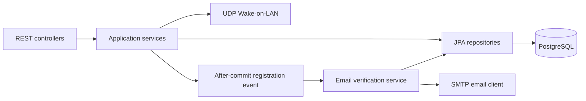

<div align="center">


# NetTools Services

**The backend services powering the NetTools homelab platform.**


[Vision](#vision) · [Capabilities](#capabilities) · [Architecture](#architecture) · [Getting started](#getting-started) · [Roadmap](#roadmap)

</div>

NetTools Services is the backend of **NetTools**, an evolving personal homelab platform designed to bring device management, network monitoring, and infrastructure automation into a unified ecosystem. It grows alongside the infrastructure it supports, turning practical needs into opportunities to explore backend engineering, security, and system integration.

This repository contains `nettools-services`: the platform's APIs, persistence, integrations, and automation services. A future `nettools-portal` will provide the frontend.

## Vision

A homelab is a changing environment: new devices, services, and operational needs continually introduce new engineering problems. NetTools provides a long-term home for the tools and integrations that emerge from that process.

The project combines practical infrastructure work with continuous learning in API design, data persistence, application security, and software architecture. Its direction is modular and incremental, with capabilities introduced as the homelab evolves rather than around a fixed commercial feature set.

## Capabilities

**Early development.** The table describes the current codebase; implemented components do not imply a complete end-to-end workflow.

| Area | Current implementation | Status and next steps |
| --- | --- | --- |
| **Wake-on-LAN** | UDP magic-packet sender on port 9, exposed through `POST /api/wol`, using one configured MAC and broadcast address. | **Implemented core.** API access depends on the unfinished authentication flow. |
| **Device management** | No device registry or user-to-device association yet. | **Planned.** Multiple registered devices per account and further device management capabilities. |
| **User registration** | `POST /api/auth/register`, input validation, duplicate checks, BCrypt password hashing, persisted users, and default role assignment. | **Implemented registration.** Account management is planned; authenticated access remains in development. |
| **Email verification** | Six-digit OTP generation, hashed token storage with a ten-minute expiry, and HTML email delivery triggered after registration commits. | **Partially implemented.** OTP validation, resend, and email-verification completion are pending. |
| **Access control** | Spring Security request rules, CSRF protection, and user/role persistence. | **In development.** Login and JWT authentication are not implemented; OAuth2 resource-server configuration is currently disabled. |
| **ZTE MC889 5G** | Modem and traffic entities, repositories, and database migrations. | **Persistence foundation.** Modem communication, scheduled collection, network-state retrieval, and historical analysis are planned. |

The current repository contains a backend API. Historical data visualization remains a future extension.

## Technology stack

| Layer | Technologies |
| --- | --- |
| Runtime and API | Java 21, Spring Boot 4.1.2, Spring Web MVC |
| Persistence | Spring Data JPA / Hibernate, PostgreSQL 17, Liquibase |
| Identity and email | Spring Security, BCrypt, Spring Mail / SMTP |
| API documentation and observability | springdoc OpenAPI / Swagger UI, Spring Boot Actuator, SLF4J / Logback |
| Build and local infrastructure | Maven, Lombok, Docker Compose for PostgreSQL |

## Architecture

NetTools Services currently runs as a single Spring Boot application organized into controller, service, repository, and integration layers, under the base Java package `dev.eusebiu.nettools`. This provides a shared foundation for the platform's growing set of capabilities.



Liquibase manages schema changes, while Hibernate is configured to validate the mappings. Registration publishes an application event handled after the user transaction commits, with verification-token persistence in a separate transaction. Shared infrastructure includes `ApiResponse` response envelopes, centralized exception handling, and HTTP request logging with trace IDs.

## Getting started

### Prerequisites

- JDK 21, with `JAVA_HOME` configured.
- Maven installed, or the included Maven Wrapper (`./mvnw` on Unix, `.\mvnw.cmd` on Windows).
- Docker with the Compose plugin for the local PostgreSQL service.
- An SMTP account for verification emails. The root configuration defaults to Microsoft 365 on port 587 with STARTTLS; `SPRING_MAIL_HOST` and `SPRING_MAIL_PORT` can override the server.

Run the following steps from the repository root. The packaged configuration imports `./application.yml`, so the working directory matters.

### 1. Configure the environment

Create a local `.env` file. There is currently no `.env.example`; use this template and replace the sample values with your own settings:

```dotenv
DB_URL=jdbc:postgresql://localhost:5439/nettools
DB_USERNAME=nettools
DB_PASSWORD=replace_with_a_local_database_password

MAIL_USERNAME=replace_with_your_smtp_username
MAIL_PASSWORD=replace_with_your_smtp_password
MAIL_FROM=nettools@example.com

WOL_MAC_ADDRESS=02:00:00:00:00:01
WOL_BROADCAST_ADDRESS=255.255.255.255
```

The MAC and broadcast values are examples; configure the target device and its LAN broadcast address. Wake-on-LAN requires compatible hardware settings and a NetTools host able to reach that LAN. Packet transmission alone does not confirm that a device has powered on.

`.env` is ignored by Git. Docker Compose reads it automatically, but Spring Boot needs these values exported into its process environment. You can also configure them directly in your IDE's run configuration.

<details>
<summary>Load the template into your terminal environment</summary>

**PowerShell** — use unquoted values, one assignment per line:

```powershell
Get-Content .env | Where-Object { $_ -match '^[A-Za-z_][A-Za-z0-9_]*=' } | ForEach-Object {
    $name, $value = $_ -split '=', 2
    [Environment]::SetEnvironmentVariable($name, $value, 'Process')
}
```

**Bash / Zsh** — quote values containing spaces or shell metacharacters:

```bash
set -a
source .env
set +a
```

</details>

### 2. Start PostgreSQL and the backend

```bash
docker compose up -d --wait postgres
mvn spring-boot:run
```

Compose starts PostgreSQL 17 with database `nettools`, a persistent volume, and host port **5439**. The backend runs on the host, uses port **8080**, and applies Liquibase migrations during startup. Substitute the Maven Wrapper for `mvn` if Maven is not installed separately.

**Current startup limitation:** the `Modem` and `Role` entity IDs use Java `Integer`, while their migrations declare `BIGINT`. Hibernate schema validation can therefore prevent startup. For local investigation, the following temporary workaround skips Hibernate validation while keeping Liquibase enabled:

```bash
mvn spring-boot:run "-Dspring-boot.run.arguments=--spring.jpa.hibernate.ddl-auto=none"
```

Aligning the entity mappings and schema is still required for normal validated startup.

### 3. Explore the API

Once the backend starts:

| Resource | Local URL |
| --- | --- |
| Health | <http://localhost:8080/actuator/health> |
| Swagger UI | <http://localhost:8080/swagger-ui/index.html> |
| OpenAPI specification | <http://localhost:8080/v3/api-docs> |

Registration, health, and the documented Swagger/OpenAPI paths are permitted by the current security rules. Other routes require authentication. In particular, `/api/wol` cannot yet be used through a completed application login flow; the sender exists, but authenticated access is still under development.

## Roadmap

- [ ] Align entity IDs with database migrations and strengthen integration coverage.
- [ ] Complete OTP verification, resend handling, authentication, and resource authorization.
- [ ] Introduce a user-owned device registry with multiple devices per account and device-specific Wake-on-LAN actions.
- [ ] Connect the ZTE MC889 integration to traffic collection and connectivity-state persistence.
- [ ] Build historical monitoring and analysis on top of collected data.
- [ ] Add homelab services, administration tools, and automations as new infrastructure needs emerge.

The roadmap is a living direction, shaped by hands-on use, technical exploration, and the evolution of the homelab.
